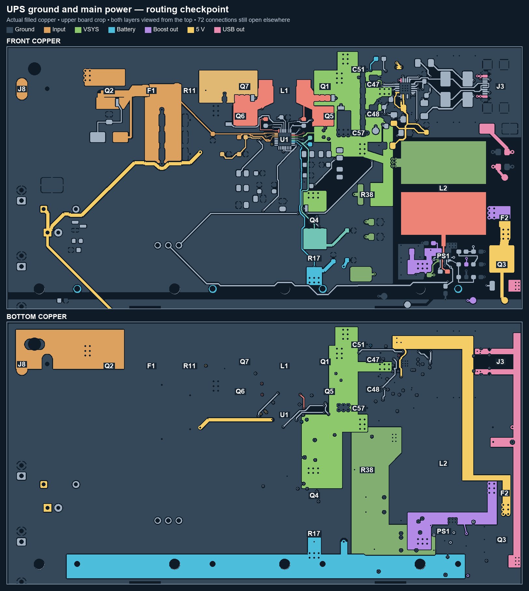
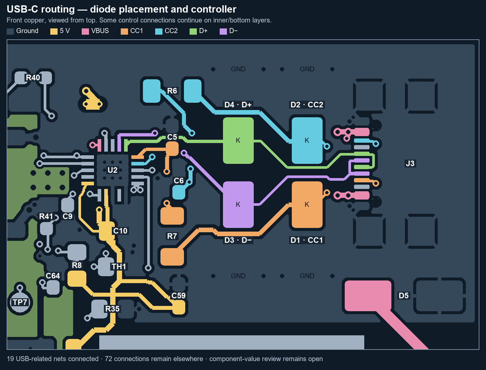
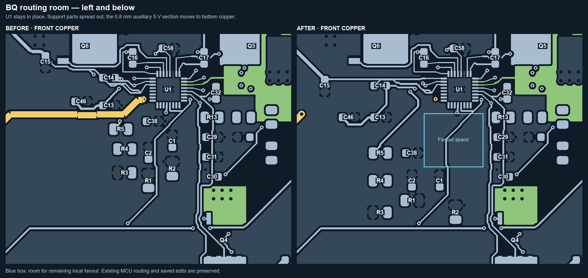
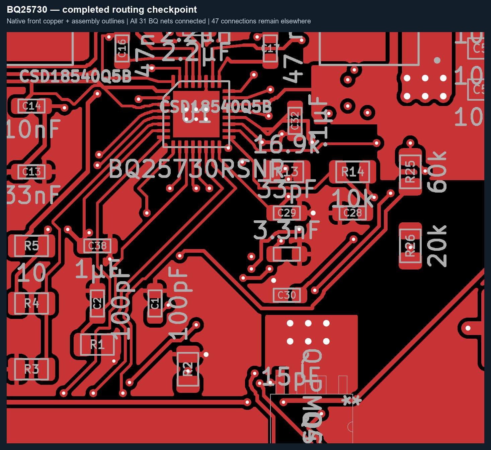
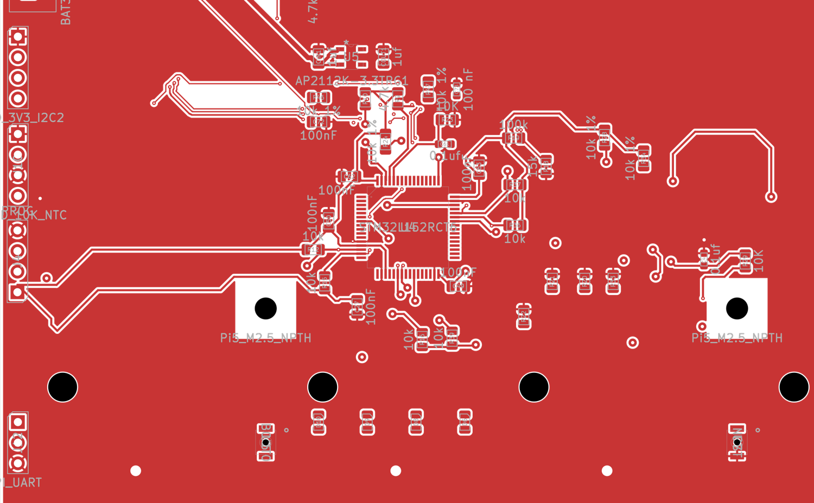

## Current control-layout checkpoint - 2026-10-20

The MCU/control routing has been rebuilt and all existing electrical nets are now connected: **0 unconnected items**. U4 remains at (101, 142) mm. The temperature-input resistor/capacitor pairs, MCU bypass capacitors, LED row, and boot/reset controls are grouped. RESET and BOOT are together near the bottom edge, with three optional GPIO-button locations reserved on Dwgs.User; no new switches or GPIO circuits were added.

Only J2/J5/J6/J11 were moved to B.Cu, into the channels between the battery holders. All temperature-input resistors and capacitors remain on F.Cu. Existing thermistor connector footprints are placeholders until replacement parts are selected; recheck the actual housing and mating-cable clearance when they are chosen.

Corrected two controller power-symbol values from 3.3V to +3.3V, joining C61.2, R29.1 and U6.2 to the regulator supply. This is the only schematic connectivity change in this pass. All 472 previously connected pad memberships remain connected; all 86 populated electrical nets, all 31 BQ nets, all 19 USB-related nets and all 14 main-power path audits pass.

Native DRC has zero shorts, copper clearances, drill conflicts, keepout violations, courtyard overlaps, incomplete thermal connections, dangling tracks/vias, or schematic parity issues. **164 other findings remain**: 44 library-footprint mismatches, 4 malformed courtyards, 48 silk-over-copper, 62 silk overlaps, 5 text-height and 1 silk-edge finding. These and the outstanding BOM/land-pattern/current/thermal review below still need resolution before fabrication.

Current evidence: [controls-cleanup.json](review/controls-cleanup.json), [controls-cleanup-drc.json](review/controls-cleanup-drc.json), [validation-summary.json](review/validation-summary.json). Pre-cleanup board: C:/Users/john/.codex/backups/UPS/2026-10-20-controls-cleanup/before.kicad_pcb; original controller schematic: original-controller.kicad_sch in that directory.

[Front controls preview](review/controls-front.png) | [Battery-side connector preview](review/controls-back.png)

Earlier sections below retain historical checkpoint counts.

---

# UPS ground, power and USB-C checkpoint

Continue in **ecad/UPS/UPS.kicad_pro**, using the single active **UPS.kicad_pcb** on branch **codex/placement-optimization**. The team baseline remains on **newmain**, commit `f5ad96ca7c6ce8b75538aafb6f14a27db1c61da7`. Close KiCad before switching branches, then reopen this same project.

The saved board now connects the grounds, charger bridge, battery bus, charger-to-boost feed, and boost-to-fuse-to-USB power path. Charger gate, bootstrap, sensing and supply connections are routed. The USB-C connector, protection, controller support and MCU control links are now routed as well. **47 unconnected items remain elsewhere; this is an unfinished board.** The input-current, battery-current, thermal and EMI limits have not been validated.

This preview uses actual filled copper and pad geometry. It crops the upper board and shows both layers from the top. Grey copper is ground; the other colours distinguish the main rails. The inner ground reference is not pictured. The battery-positive bus crosses the bottom of the crop.

## What changed on 20 October 2026

- Added bounded power pours and multiple-via transitions from the DC jack through protection, shunt and charger, through the battery branch and boost input, and from boost output through F2/Q3 to the USB connector. The new power transitions generally use 3 × 2 arrays; their dimensions and bottlenecks still need current/thermal review.
- Retained the broad In1.Cu ground reference. Restored front ground coverage around the separate power regions and retained bottom ground. Added deliberate ground returns for C13, C30 and C38, and corrected incomplete thermal connections rather than relaxing the design rules.
- Routed the charger gate drives, bootstrap capacitors, current-shunt sensing, filter capacitors and REGN branch. Small control traces use F.Cu, In2.Cu and B.Cu; no new signal tracks cut the In1.Cu reference plane.
- Added the 5 V auxiliary branch to the fan and MCU regulator. U1 moved down 1 mm; C32 moved beside its sensing pins. F2 was reversed, Q3 shifted left, and D1/D3/C6 moved for clearance. The battery holders and Pi mounts retain their established locations.
- Preserved the user's C13 correction: C13 pin 2 is GND, while U1 pin 31 HIDRV1 connects only to Q7 gate pin 4. The resistor values and land patterns remain provisional pending physical stock identification.

The original four-layer stack, board constraints and net settings are unchanged. The user's saved schematics and project settings were not edited during this ground/power pass. A pre-pass snapshot and the construction utilities are outside the checkout at `C:/Users/john/.codex/backups/UPS/2026-10-20-125918-ground-power-pass/`. Continue editing the active board in place; those utilities reconstruct older intermediate states.

## USB-C routing pass — 20 October 2026

Rotated and repositioned D1–D4 into two pairs. Their signal cathodes face the central connector routes; each ground anode has two short off-pad ground-via connections. R6/R7 were repositioned for the CC paths. C9/C10 moved toward U2's supply pins, with R8/TH1/R35 adjusted to make room. All values, footprints, schematic nets and the user's saved project settings are unchanged during this pass.

The CC paths, both orientations of D+/D−, local filters, VDD/VCC supply, NTC, battery-voltage divider, SCL/SDA links, voltage-select signals and switched Q3 gate path are connected. D+/D− go to the charging controller in this schematic; this routing does not establish a USB host data interface. The inner ground plane remains the reference. U2 now has nine exposed-pad thermal vias; confirm their assembly treatment before release.

Native connectivity checks confirm **all 19 USB-related nets** have all their pads connected, including the shared buses and supply. No ground or USB-related net remains in the unconnected-item report. Six unattached legacy VSEL1 track/via fragments were removed after routing the actual MCU connection. New tracks/vias are grouped as **13 USB-C signals and controller**. The pre-pass board and recovery snapshots are outside the checkout at `C:/Users/john/.codex/backups/UPS/2026-10-20-usbc-routing/`.

**C9 needs value review:** it is marked **470 pF**, while [the MPQ5031 datasheet](https://www.monolithicpower.com/en/documentview/productdocument/index/version/2/document_type/Datasheet/lang/en/sku/MPQ5031GRE-AEC1/document_id/8999/) specifies **0.47 µF (470 nF)** on VDD. Its value was left unchanged. The D3/D4 protection part-number discrepancy in the BOM table also remains open. Check both before assembly.

## BQ routing-room adjustment — 20 October 2026

Opened the **−X / +Y sides of U1** by moving twelve support parts. C15/C14/C13/C46 form a wider-spaced bank to the left; R5/C38/R4/C1/C2/R1/R2/R3 sit farther left or lower. U1, the charger bridge, L1 and the battery/boost hardware retain their positions. The blue box marks approximately 7.5 × 6.8 mm of working area around the retained routing; an existing SCL trace still crosses it.

The short **fan/logic 5 V branch** that crossed the front at Y≈63.1 mm now runs on **B.Cu**, retaining **0.8 mm width**, from (96.6, 63.1) to the existing via at (113.5, 61.2). A new 0.8/0.4 mm via provides the left transition. This conductor width and the existing end-via bottleneck still require the established current/thermal review.

Repaired the affected filter, VBUS-supply and REGN connections and the moved ground returns. All previously connected pads remain connected, values/footprints/nets are unchanged, and the four route items the user saved before this pass are preserved. No new MCU signal routing was undertaken. The unconnected-item count remains **72**. New work is grouped as **20 BQ routing room adjustments**.

The saved pre-pass board and final recovery checkpoint are archived outside the active project at `C:/Users/john/.codex/backups/UPS/2026-10-20-bq-routing-room/`. Continue with the same active PCB on this branch. [bq-routing-room.json](review/bq-routing-room.json) records movement and preservation checks.

## BQ routing completion — 20 October 2026

Completed all **31 electrical nets on U1**, including VDDA filtering, ILIM, IADPT/IBAT/PSYS, both compensation networks, cell selection and the CHRG_OK, OTG/VAP, PROCHOT, CMPIN and CMPOUT links. The whole-board unconnected count fell from **72 to 47**; all remaining missing connections are outside these BQ nets.

Preserved the user's saved component positions, values, footprints, net assignments, schematics and project settings. Reworked the local SCL/SDA escapes and the SRP/SRN sense branches to open the fine-pitch exits. The auxiliary 5 V branch now bypasses the BQ area on **B.Cu at 0.8 mm width**. Added explicit ground returns at R1, C38 and U4 VSSA; R1's ground pad has a local solid connection to its pour. The In1.Cu ground reference remains free of signal tracks. Removed redundant transition vias and unused routing tails.

Native refill/DRC confirms **zero** shorts, clearance violations, drill conflicts, inadequate connection widths or incomplete thermals, and **zero** schematic parity issues. All prior pad connections are preserved. All **19 USB-related nets** and **14 main-power terminal groups** were rechecked; the power groups remain connected in an analysis copy without thin signal routing. There are **178 remaining non-connectivity findings**, including the existing silk, library, courtyard and dangling-via findings. This is a connectivity checkpoint; conductor current/thermal limits and switching/analog layout performance still require review.

New routing is grouped as **21 BQ completion routing**. Recovery files, including the user's unmodified saved board, are at `C:/Users/john/.codex/backups/UPS/2026-10-20-bq-finish/`. [bq-routing-finish.json](review/bq-routing-finish.json) records preservation and per-net connectivity; [bq-finish-drc.json](review/bq-finish-drc.json) is the current native report.

## Arrangement

| Area | Arrangement |
|---|---|
| Bottom | Four Keystone 1121 battery holders; no other bottom components. Bottom copper carries the battery bus, power transitions and ground. |
| Top left | Barrel input, reverse protection, input fuse, shunt and capacitor bank. |
| Upper centre | Charger bridge, L1 and adjacent capacitors; compensation and sensing parts below. |
| Upper right | Boost L2/PS1, input bypass, output capacitors, output fuse, MOSFET and USB-C stage. |
| Lower left | MCU island and retained useful local routing. |
| Left edge | Programming, display, temperature and UART connectors. |
| Between holders | Pi mounting hardware and reset/boot access. |

The outline remains **121.92 × 139.70 mm**, with **173 footprints**. Use the native [front assembly drawing](review/native-front-assembly.svg), [bottom assembly drawing](review/native-bottom-assembly.svg), or KiCad for the full board; the native bottom drawing is mirrored for an underside view.

## Pi 5 boot arrangement

The UPS sits underneath the Pi, with batteries down. Four **2.7 mm NPTH** holes have **58 × 49 mm** centre spacing:

| Mount | X, mm | Y, mm |
|---|---:|---:|
| H1 | 83.5 | 103 |
| H2 | 141.5 | 103 |
| H3 | 83.5 | 152 |
| H4 | 141.5 | 152 |

The Pi envelope on Dwgs.User is 85 × 56 mm, from (80, 99.5) to (165, 155.5). Mounts are marked board-only and locked. Each has a 7.5 mm square copper/track/via exclusion; component placement was also checked against the hardware envelope. The holder channels are approximately 8.28 mm wide, leaving about 0.39 mm per side beyond that envelope.

These are nominal dimensions from the [official Pi 5 mechanical drawing](https://pip-assets.raspberrypi.com/categories/892-raspberry-pi-5/documents/RP-008347-DS-1-raspberry-pi-5-mechanical-drawing.pdf). That drawing is explicitly a reference rather than production data. Verify the physical Pi, holder tolerances, hardware diameter, underside components, cable access, and standoff height before committing the mechanics. Pi antenna clearance and wireless performance also need a stack-level check.

## Current and EMI review still required

The [team messages](inputs/team-layout-intent.md) specify large rail pours and suggest 3 × 2 via arrays. They do not include the via dimensions or the calculation behind the earlier single-via 5 A estimate. Final conductor widths, necks, thermal spokes, plating and current limits therefore remain provisional.

The layout follows the intent of [TI's BQ257xx layout guide](https://www.ti.com/lit/pdf/sluaau1) and [TPS61288 guidance](https://www.ti.com/lit/gpn/tps61288): local switching copper, an inner ground reference, separate shunt-sensing connections and quiet filter returns. Native connectivity and clearance checks do not establish switching stability, loop inductance, EMI performance or temperature rise. Review the actual gate-drive/sense geometry and complete a current/thermal budget before release.

The battery/boost input can carry substantially more current than the 5 V output. As an illustration, 25 W from 3.0 V at an assumed 90% efficiency needs about 9.3 A input; this is not the team's design-current calculation. Check the R38 zero-ohm link and its package rating along with every rail bottleneck.

New small signal vias reach **0.46 mm diameter / 0.2032 mm drill**. New power transitions commonly use **0.80 / 0.40 mm**, with **0.60 / 0.30 mm** at constrained output connections. Exposed-pad thermal vias under U1/U2 are intentional; confirm paste, tenting/filling and solder-wicking treatment with the assembler. Existing trial-route vias and all land patterns still need assembly review.

## BOM use and unresolved decisions

The CSVs in `inputs/` are unmodified copies. The package-to-reference mapping below follows circuit function and the matching six- and seven-part quantities; the BOM does not assign those reference designators explicitly.

| Item | Candidate treatment / remaining issue |
|---|---|
| Six VBUS capacitors, GRM32DR71E106KA12K | C39–C44 changed from 0603 to **1210**, then re-spaced. [Murata lists the part family as 3225M/1210](https://www.murata.com/-/media/webrenewal/tool/library/common-pdf/dynamic-model/component-list-d-mlcc-2504.ashx?cvid=20250523010405000000&la=en). Values and nets remain 10 µF and unchanged. |
| Seven loop capacitors, GRM21BR61C106KE15L | C51–C57 changed from 0603 to **0805**. [Murata's part drawing confirms 2012M/0805](https://search.murata.co.jp/Ceramy/image/img/A01X/G101/ENG/GRM21BR61C106KE15-01A.pdf). Values and nets remain unchanged. |
| U1 BQ25730 | Replaced the overlapping custom RSN footprint with KiCad's Texas RSN WQFN-32, 4 × 4 mm, 0.4 mm pitch, 2.8 mm exposed-pad footprint. Its package matches the [TI RSN0032B drawing](https://www.ti.com/lit/gpn/bq25730). The copied schematic uses the same footprint. |
| R11 / R17 | Schematic is **10 mΩ**; BOM WSLF25121L300FEA encodes **1.3 mΩ**. Physical stock is unidentified; retain the existing 10 milliohm values and generic 2512 footprints provisionally. The BOM part has a 2512 body, but Vishay recommends 1.80 by 3.40 mm pads with a 3.40 mm gap; the current pads are 1.225 by 3.35 mm with a 4.70 mm gap. Confirm the physical part and land pattern before assembly; current-limit scaling still needs review. See [Vishay's numbering guide](https://www.vishay.com/docs/30193/wslf.pdf). |
| L1 | BOM selects Bourns SRP1038A-2R2M; the existing footprint remains Vishay IHLP-4040. Verify/replace against the [Bourns land pattern](https://www.bourns.com/docs/product-datasheets/srp1038a.pdf) before finalising this stage. |
| D3 / D4 protection | The BOM calls these 3.5 V but specifies **SMBJ51A**, a 51 V standoff device. That is not an equivalent clamp. Select protection voltage and capacitance for the actual USB signals. [Good-Ark datasheet](https://goodarksemi.com/docs/datasheets/transient_voltage_suppressors/SMBJx.pdf). |
| J8 input jack | BOM rows list multiple barrel-jack parts; the board uses CUI PJ-002AH. Confirm the physical purchased part and footprint. |
| J7 fan | The existing LED-shaped two-hole footprint is retained. Select a proper connector and mating harness before final routing. |
| Other discrepancies | VSYS bulk-cap value/listing, duplicate TPS61288 versus TPS61288L entries, and several resistor/capacitor part-number/package labels need final BOM reconciliation. No purchasing substitutions were made. |

## Electrical issues carried forward

Native schematic export and PCB parity confirm the user-corrected C13/HIDRV1 topology. Relative to the team baseline, only U1 pin 31 and Q7 pin 4 were separated from GND; C13 pin 2 remains grounded. This approved difference is recorded in `review/approved-net-changes.json`. The user's schematic review note is preserved.

The separate net **3.3V** still connects C61 pin 2, R29 pin 1 and U6 pin 2; it is distinct from the MCU's **+3.3V** rail. Review that boot-circuit supply before finishing its routing. The unresolved BOM/package decisions above also remain open.

## Validation

The saved native KiCad DRC, with zones refilled under the original board constraints, reports:

- **0** copper shorts, spacing violations, crossing tracks, incomplete thermals, courtyard overlaps, drill conflicts, keepout infringements, copper-edge conflicts or solder-mask bridges.
- **0** schematic/PCB parity issues.
- **47 unconnected items**, down from **72** before BQ completion, **104** before the USB pass and **296** before the ground/power pass. No ground, main-power or USB-related net appears in the remaining unconnected-item report.
- **178 other findings**: 52 silk-over-copper, 55 silk overlaps, 44 library-footprint mismatches, 5 silk-edge findings, 5 text-height findings, 4 malformed courtyards and 13 dangling vias. These remaining findings predate BQ completion.

A separate analysis copy removed **324** thin track/via items from the main-power nets. All **14** critical terminal groups remained connected after native refill, retaining **16** short package-escape items near PS1/J3. This checks that sensing tracks do not substitute for the main bus; it does not certify minimum copper cross-section or current capacity. Details are in [main-power-connectivity.json](review/main-power-connectivity.json).

The board has **2,204 track/via items**. [validation-summary.json](review/validation-summary.json) records the current checks. Run `tools/verify_candidate.py` after refreshing the native netlist, DRC, geometry and USB/main-power connectivity evidence for subsequent edits. Source manifests and the team's baseline remain in Git and `review/`; earlier boost-trial files in that folder are historical evidence.

Next, finish the remaining MCU and connector signals, resolve the stock shunts and outstanding land patterns, review current/thermal and switching geometry, then clean silkscreen, courtyards and dangling routing before fabrication review.

### STM32 routing room - 2026-10-20

Moved U4 and 28 nearby support parts 30 mm right and 5 mm up to place U4 at (101, 142) mm. Board outline, Pi mounting holes, connectors and other component positions are unchanged. Repaired 14 boundary/keepout routes and preserved all 472 checked prior pad memberships. All 31 BQ nets, 19 USB nets and 14 main power paths pass. Zero native shorts, clearance, courtyard overlap, keepout, dangling-track or schematic-parity findings. Unfinished connections remain at 47; other DRC findings total 180.

Evidence: review/stm-routing-room.json, review/stm-room-drc.json, review/validation-summary.json. Backup: C:/Users/john/.codex/backups/UPS/2026-10-20-stm-routing-room/before.kicad_pcb.

