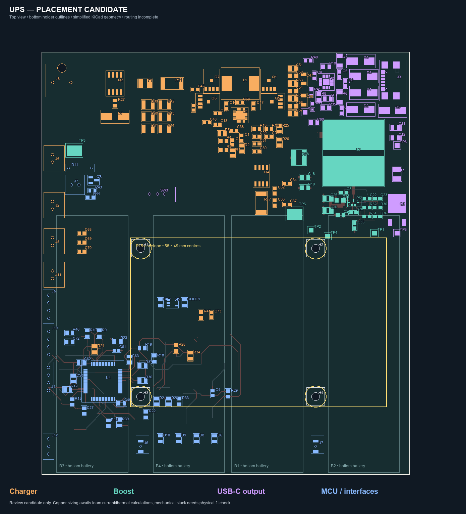
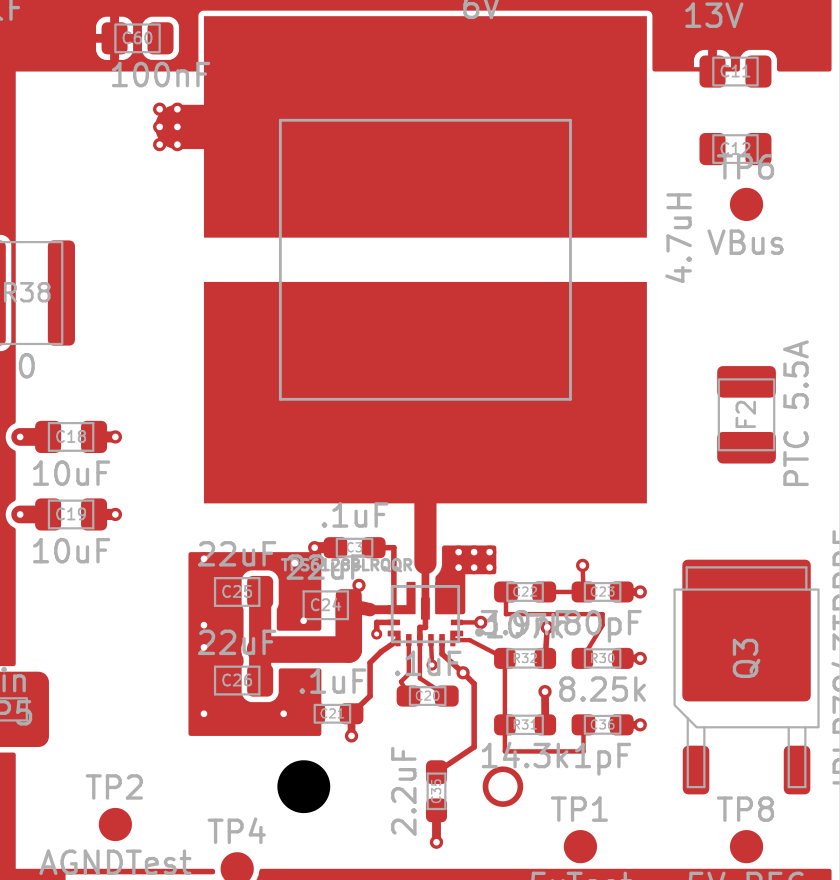

# UPS placement — branch `codex/placement-optimization`

Open **ecad/UPS/UPS.kicad_pro** and continue editing **ecad/UPS/UPS.kicad_pcb** on branch **codex/placement-optimization**. There is one active board at the normal project path. The branch also includes its local footprint libraries, supplied BOMs, and review evidence.

The team's starting design remains on **newmain**, at commit `f5ad96ca7c6ce8b75538aafb6f14a27db1c61da7`. Switch Git branches to compare versions. Close KiCad before switching branches and reopen this same project afterward so an old editor session cannot overwrite the checked-out version.

**Placement and boost-trial clearance checks pass under the original project constraints. Routing, thermal connections, and electrical review remain unfinished; this board is not ready for fabrication.**

The overview simplifies pad geometry. Use the native [front assembly drawing](review/native-front-assembly.svg), [bottom assembly drawing](review/native-bottom-assembly.svg), or KiCad for exact pad shapes and drill locations. The bottom drawing is mirrored to show the underside.

## Arrangement

| Area | Arrangement and reason |
|---|---|
| Bottom | Four Keystone 1121 battery holders only. Keep other components on top; reserve bottom copper for return paths and heat spreading after routing review. |
| Top left | Barrel input, input protection, and input capacitor bank. |
| Upper centre | Charger bridge, L1, and local capacitors grouped into a compact power stage. Compensation and sensing parts sit below the switching components. |
| Upper right | Boost inductor and PS1 grouped with input bypass, output capacitors, and compensation. USB-C and its controller are above the holders, so connector pins do not protrude into holder bodies. |
| Lower left | MCU island shifted 3.5 mm left, retaining relative component placement and useful local routing. |
| Left edge | Programming, display, temperature, and UART connector pins occupy the free strip beside the holders. |
| Between holders | Two channels carry the Pi mounting hardware. Reset/boot buttons sit in those channels beyond the Pi board envelope. |

The nominal rectangular outline remains **121.92 × 139.70 mm**. The candidate contains eight named KiCad groups so stages can be selected and adjusted together.

## Pi 5 boot arrangement

The UPS sits underneath the Pi, with batteries down. Four **2.7 mm NPTH** holes have **58 × 49 mm** centre spacing:

| Mount | X, mm | Y, mm |
|---|---:|---:|
| H1 | 83.5 | 103 |
| H2 | 141.5 | 103 |
| H3 | 83.5 | 152 |
| H4 | 141.5 | 152 |

The Pi envelope on Dwgs.User is 85 × 56 mm, from (80, 99.5) to (165, 155.5). Mounts are marked board-only and locked. Each has a 7.5 mm square copper/track/via exclusion; component placement was also checked against the hardware envelope. The holder channels are approximately 8.28 mm wide, leaving about 0.39 mm per side beyond that envelope.

These are nominal dimensions from the [official Pi 5 mechanical drawing](https://pip-assets.raspberrypi.com/categories/892-raspberry-pi-5/documents/RP-008347-DS-1-raspberry-pi-5-mechanical-drawing.pdf). That drawing is explicitly a reference rather than production data. Verify the physical Pi, holder tolerances, hardware diameter, underside components, cable access, and standoff height before committing the mechanics. Pi antenna clearance and wireless performance also need a stack-level check.

## Power and EMI intent

The [team messages supplied by the user](inputs/team-layout-intent.md) establish the MCU-at-bottom-left floorplan, large VSYS/5 V/VBUS pours, and provision for 3 × 2 via arrays. The boost trial now has real, net-assigned 3 × 2 via arrays at its DC-input and local power-ground connections. Other power stages remain unfinished. Rail labels on Dwgs.User are planning annotations; the former array circles were removed to avoid confusing them with real vias.

The original four-layer stack and project settings are preserved. Ground zones are present on F.Cu, In1.Cu, and B.Cu. The inner ground reference should remain continuous beneath signal paths; sensitive feedback and current sensing need local, quiet returns. The front ground fill is notched around the boost stage, where bounded output-return and power-ground copper is used. The bottom ground fill remains, with a higher-priority, bounded DC-input pour. Broad ground coverage elsewhere is intentional. Final high-current rail dimensions and stitching still need thermal/current review.

For the routing pass:

- Complete the charger and boost switching loops first, with their adjacent capacitors and short switch-node copper. Follow [TI's BQ257xx layout guide](https://www.ti.com/lit/pdf/sluaau1) and the [TPS61288/L layout guidance](https://www.ti.com/lit/gpn/tps61288).
- Give input and battery shunts dedicated Kelvin connections. Keep gate-drive, feedback, and compensation paths away from switching copper.
- Size each DC rail separately for voltage drop and temperature rise. A 5 A output does not imply a 5 A battery path: as an illustration, 25 W at 3.0 V and an assumed 90% efficiency requires about 9.3 A input. This is an example, not the team's design current.
- Choose via drill, plating, pad, number, and distribution from the actual current and thermal requirements. The messages do not contain the dimensions or calculation supporting the earlier single-via 5 A estimate.
- Check thermal-relief spokes and pad necks as current bottlenecks. Large pours and multiple vias alone do not establish current capacity or EMC performance.

## Boost routing checkpoint — 20 October 2026

PS1 is rotated toward L2. Its output capacitor bank is to the left, compensation and feedback parts to the right, and Q3 is turned along the board edge. The bootstrap, VIN bypass, VCC/EN, feedback and compensation connections are routed locally. Six DC-input vias feed a bounded B.Cu input pour; six power-ground vias and separate local analog-ground connections meet the inner ground reference. Output sensing is taken from the output capacitor bank. In2 carries short control connections; the output-sense connection uses B.Cu.

This proves a locally connected arrangement under the current clearance rules. It does **not** establish output current, regulator stability, temperature rise, or EMI performance. The package escapes, input-via bottleneck, output bus, ground return, and exposed-pad connections need a current/thermal review. Several signal vias are 0.50 mm diameter / 0.23 mm drill; the power-array vias are 0.60 / 0.30 mm. Confirm fabrication capability and plating before release.

The charger-to-boost feed, boost-to-F2/Q3/output power path, and the rest of the board remain unfinished. Do not treat the local trial as a completed supply. The next efficient step is to review this boost loop and its actual current requirements, resolve the charger schematic issues below, then route that charger stage before general signals. Keep the copper fills while reviewing connectivity; hide filled areas in KiCad when they obscure pad/trace inspection.

The prior placement checkpoint is commit `f051c72`; the pre-trial native files and construction utility are archived outside the checkout at `C:/Users/john/.codex/backups/UPS/2026-10-20-boost-trial/`. Continue editing the one active PCB rather than rebuilding from that snapshot.

## BOM use and unresolved decisions

The CSVs in `inputs/` are unmodified copies. The package-to-reference mapping below follows circuit function and the matching six- and seven-part quantities; the BOM does not assign those reference designators explicitly.

| Item | Candidate treatment / remaining issue |
|---|---|
| Six VBUS capacitors, GRM32DR71E106KA12K | C39–C44 changed from 0603 to **1210**, then re-spaced. [Murata lists the part family as 3225M/1210](https://www.murata.com/-/media/webrenewal/tool/library/common-pdf/dynamic-model/component-list-d-mlcc-2504.ashx?cvid=20250523010405000000&la=en). Values and nets remain 10 µF and unchanged. |
| Seven loop capacitors, GRM21BR61C106KE15L | C51–C57 changed from 0603 to **0805**. [Murata's part drawing confirms 2012M/0805](https://search.murata.co.jp/Ceramy/image/img/A01X/G101/ENG/GRM21BR61C106KE15-01A.pdf). Values and nets remain unchanged. |
| U1 BQ25730 | Replaced the overlapping custom RSN footprint with KiCad's Texas RSN WQFN-32, 4 × 4 mm, 0.4 mm pitch, 2.8 mm exposed-pad footprint. Its package matches the [TI RSN0032B drawing](https://www.ti.com/lit/gpn/bq25730). The copied schematic uses the same footprint. |
| R11 / R17 | Schematic is **10 mΩ**; BOM WSLF25121L300FEA encodes **1.3 mΩ**. Resolve the intended resistance and firmware/current-limit scaling before routing. See [Vishay's numbering guide](https://www.vishay.com/docs/30193/wslf.pdf). |
| L1 | BOM selects Bourns SRP1038A-2R2M; the existing footprint remains Vishay IHLP-4040. Verify/replace against the [Bourns land pattern](https://www.bourns.com/docs/product-datasheets/srp1038a.pdf) before finalising this stage. |
| D3 / D4 protection | The BOM calls these 3.5 V but specifies **SMBJ51A**, a 51 V standoff device. That is not an equivalent clamp. Select protection voltage and capacitance for the actual USB signals. [Good-Ark datasheet](https://goodarksemi.com/docs/datasheets/transient_voltage_suppressors/SMBJx.pdf). |
| J8 input jack | BOM rows list multiple barrel-jack parts; the board uses CUI PJ-002AH. Confirm the physical purchased part and footprint. |
| J7 fan | The existing LED-shaped two-hole footprint is retained. Select a proper connector and mating harness before final routing. |
| Other discrepancies | VSYS bulk-cap value/listing, duplicate TPS61288 versus TPS61288L entries, and several resistor/capacitor part-number/package labels need final BOM reconciliation. No purchasing substitutions were made. |

## Electrical issues carried forward

Fresh native netlist exports confirm that the candidate's **electrical topology is identical to the saved source**, including these unresolved issues:

1. U1 pin 31 **HIDRV1** and Q7 gate pin 4 are on **GND**. This conflicts with their intended high-side gate-drive function and requires schematic review before powering the design.
2. The separate net **3.3V** connects C61 pin 2, R29 pin 1, and U6 pin 2; it is distinct from the MCU's **+3.3V** rail. Review the boot circuit's intended supply/reference.

The placement work does not establish charger stability, battery protection adequacy, USB-C behaviour, power capability, thermal performance, or EMC compliance.

## Validation and preservation

The final native KiCad DRC, with zones refilled and the original project constraints, reports:

- **0** copper shorts, clearance violations, courtyard overlaps, drill-clearance conflicts, hole-to-hole conflicts, keepout infringements, or copper-edge violations.
- **0** schematic/PCB parity issues.
- **211 unconnected items** (down from 232 before the boost trial). This is an unfinished routing candidate.
- **214 remaining DRC findings**: 62 silk-over-copper, 57 silk overlap, 44 library-footprint mismatches, 22 dangling tracks, 10 incomplete thermal connections, 6 silk-edge findings, 5 text-height findings, 4 malformed courtyards, and 4 dangling vias.

There are **173 footprints**, including four board-only mounts, and **386 track/via items**: 275 retained or translated from the original 635, plus 111 added in this routing trial. Copper attached to relocated components or conflicting with the new mechanics was removed from this branch and recorded. The starting board is preserved in Git at `f5ad96ca7c6ce8b75538aafb6f14a27db1c61da7:ecad/UPS/UPS.kicad_pcb`.

Source SHA-256 hashes, the Git baseline manifest, native exports, movement records, packing refinements, routing actions, and DRC reports are retained in `review/`. The source manifest records the files captured before placement changes. Extra native board copies and the source autosave were archived outside the checkout. The autosave had the same footprint positions and track count as the saved board, apart from one unused mechanical footprint.

Run `tools/verify_candidate.py` with Python to check the saved evidence and preserved Git baseline. Regenerate `candidate-placement.json` using `tools/inspect_board.py` with KiCad's Python after later board edits, and rerun native netlist export/DRC before verification. **Continue editing the board in place on this branch.** The initial reconstruction script is archived with the old copies, rather than kept beside the active board.
